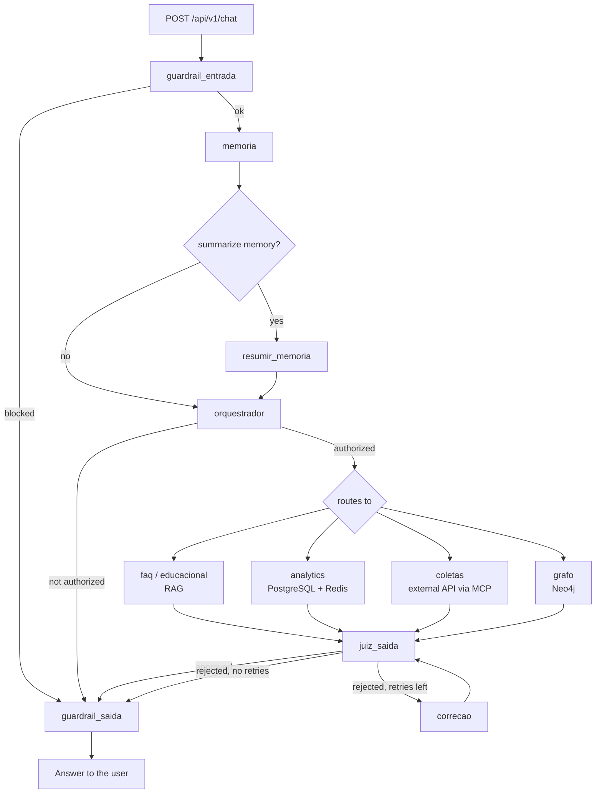

# EcoCiente IA

**English** · [Português (Brasil)](README.pt-BR.md)


> EcoCiente's multi-agent API: FastAPI + LangChain/LangGraph orchestrating specialists (FAQ, environmental education, waste collection, analytics and a relationship graph) with RAG, persistent conversational memory, input/output guardrails, a hallucination judge and MCP/A2A integrations.

## About

EcoCiente is a recycling-management platform for residential and commercial condominiums that
connects residents, building managers (*síndicos*) and waste-picker cooperatives. This repository
is its AI backend: a multi-agent chatbot that answers differently depending on the authenticated
profile (`usuario_comum`, `sindico_residencial`, `sindico_comercial`, `morador_residencial`,
`usuario_comercial`, `cooperativa`), each with its own permission scope.

Every user message goes through a deterministic LangGraph pipeline: input validation, memory
retrieval, routing to the right specialist, output validation by a judge and, if rejected, one
correction round — all instrumented with Prometheus and exposed through FastAPI.

| Profile | Can access |
| --- | --- |
| `usuario_comum` | `faq`, `educacional` |
| `sindico_residencial` / `sindico_comercial` | `faq`, `educacional`, `analytics`, `coletas`, `grafo` |
| `morador_residencial` | `faq`, `educacional`, `analytics` (own data), `grafo` |
| `usuario_comercial` | `faq`, `educacional`, `analytics` (own data), `coletas` |
| `cooperativa` | `faq`, `coletas` |

The full authorization rules (profile × action, not just profile × agent) live in
`src/security/policies.py`.

> [!NOTE]
> The domain is Brazilian, so identifiers, prompts, API fields and most docs in `docs/` are in
> Portuguese (`mensagem`, `condominio_id`, `síndico`…). This README translates the concepts.

### Status

The project is under active development. Current state:

- [x] LangGraph pipeline with input/output guardrails, memory and a correction judge
- [x] `faq` and `educacional` specialists via RAG (FAISS + local knowledge base + an external source)
- [x] `analytics` specialist over PostgreSQL (read-only queries) and Redis rankings
- [x] `coletas` specialist integrated with the external calendar API through MCP
- [x] `grafo` specialist over Neo4j for paths, connections and influence between entities
- [x] Conversational memory persisted in MongoDB with automatic summarization
- [x] Authorization per profile and per sensitive action (`src/security/policies.py`)
- [x] Per-user tool scope: the LLM cannot pick whose data a tool reads (`src/security/tool_scope.py`)
- [x] Output judge checks the draft against the evidence the specialist actually retrieved (RAG chunks or tool results)
- [x] Observability with Prometheus (`/metrics`), Grafana dashboard and aggregated healthcheck (`/health`)
- [x] Cost, cost per resolution and ROI projected for 100 and 1000 weekly users (`GET /api/v1/costs`)
- [x] LLM tracing with Langfuse (self-hosted) or LangSmith, with PII masked
- [x] Daily quota per profile, per-minute rate limit and a Redis session lock across replicas
- [x] SSE endpoint `/api/v1/chat/stream` with pipeline progress
- [x] FAQ via vector search in Qdrant (`FAQ_BACKEND=qdrant`), answering with curated text and no LLM call
- [x] Incremental, scheduled ETL from PostgreSQL to Neo4j, validated against PostgreSQL 16 with up to 1.8M votes
- [x] Routing evals (`python -m evals.routing.run`) with accuracy, per-route F1 and a confusion matrix
- [x] A2A server and MCP server for integration with other agents
- [x] GitHub Actions CI running the `pytest` suite
- [x] Run the routing evals with the production model and record the reference accuracy
- [x] Run `python -m src.etl.populate_graph --validar` on Aura and record real timings
- [x] `grafo` agent tool to query course recommendations
- [x] Long-term memory per user across conversations (`GET`/`DELETE /api/v1/memory`)
- [ ] A2A client used by the agents to consult external agents

## Prerequisites

- Python `3.11` or later
- PostgreSQL `14+`, MongoDB and Redis (they can run in Docker)
- Neo4j `5+` (optional — only needed by the `grafo` specialist; the API starts without it)
- Qdrant (optional — only with `FAQ_BACKEND=qdrant`)
- Ollama running locally (default LLM/embeddings provider) **or** a Groq/Gemini/DeepSeek key
- Docker and Docker Compose, if you run the databases in containers

## Installation

Clone the repository:

```bash
git clone https://github.com/EcoCiente-Instituto-J-F/ia-eko.git
cd ia-eko
```

Create and activate a virtual environment:

```bash
python -m venv .venv
source .venv/bin/activate      # Linux/macOS
.venv\Scripts\activate         # Windows
```

Install the dependencies:

```bash
pip install -r requirements.txt
```

> To use Groq, Gemini or DeepSeek as the LLM provider, install `requirements-optional.txt`
> instead (it already includes the base `requirements.txt`).

Configure the environment variables:

```bash
cp .env.example .env           # Windows: copy .env.example .env
```

<details>
<summary>Main <code>.env</code> variables</summary>

| Variable | Default | Description |
| --- | --- | --- |
| `APP_ENV` | `development` | `development`, `test` or `production` |
| `LLM_PROVIDER` | `ollama` | `ollama`, `groq`, `gemini`, `deepseek` or `mock` (no API cost, used by the tests) |
| `OLLAMA_BASE_URL` / `OLLAMA_MODEL` | `http://localhost:11434` / `qwen3:4b` | Local LLM via Ollama |
| `POSTGRES_URL` | — | Source of truth for analytics data (queried read-only) |
| `MONGODB_URI` / `MONGODB_DATABASE` | `mongodb://localhost:27017` / `ecociente` | Conversational memory of the sessions |
| `REDIS_URL` | `redis://localhost:6379/0` | Rankings, session pointer, usage quotas and the session lock |
| `NEO4J_URI` / `NEO4J_USERNAME` / `NEO4J_PASSWORD` / `NEO4J_DATABASE` | `bolt://localhost:7687` / `neo4j` | Relationship layer used by the `grafo` specialist (optional) |
| `KNOWLEDGE_BASE_PATH` | `data/FAQ_KNOWLEDGE_BASE.md` | RAG base of the `faq` and `educacional` specialists |
| `CALENDAR_API_BASE_URL` | `http://localhost:9800` | External collection-calendar API, consumed via MCP |
| `AUTH_API_URL` | — | External API that validates the bearer token and returns the user's claims |
| `JUDGE_MAX_CORRECTIONS` | `1` | How many times the output judge may ask for a correction |
| `MEMORY_MAX_MESSAGES` / `MEMORY_KEEP_RECENT_MESSAGES` | `20` / `6` | When and how much of the memory is summarized |
| `LLM_PRICE_INPUT_PER_1M_BRL` / `LLM_PRICE_OUTPUT_PER_1M_BRL` | `0` | Provider price per 1M tokens (R$); `0` = Ollama |

See `.env.example` for the full list (cost premises, tracing, integration tests, A2A…).

</details>

> [!NOTE]
> `docker-compose.yml` starts the `api`, Prometheus and Grafana (plus `graph-etl` under the `etl`
> profile). The databases (Postgres, MongoDB, Redis, Neo4j, Qdrant) are **not** in it: they must
> be reachable at the addresses in `.env`. To develop without any of them, use
> `STORAGE_MODE=memory` and `LLM_PROVIDER=mock`.

## Usage

With the dependencies up and `.env` filled in:

```bash
python -m uvicorn src.api.main:app --reload
```

The API listens on `http://127.0.0.1:8000`. Main endpoints:

| Method | Route | Description |
| --- | --- | --- |
| `POST` | `/api/v1/chat` | Sends a message and returns the routed specialist's answer |
| `POST` | `/api/v1/chat/stream` | Same pipeline, with per-step progress over SSE (`session` → `progress` → `answer` → `done`) |
| `GET` | `/api/v1/chat/quota` | How many answers the user still has today |
| `GET` | `/api/v1/agents` | Lists the available specialists |
| `POST` / `GET` / `DELETE` | `/api/v1/sessions`, `/api/v1/sessions/{session_id}` | Creates, reads and closes a conversation session |
| `GET` / `DELETE` | `/api/v1/memory` | What the assistant remembers about the user across conversations; delete it at any time |
| `GET` | `/api/v1/rankings/moradores`, `/torres`, `/me` | Recycling rankings (per profile) and the user's own position |
| `GET` | `/api/v1/costs` | Cost, cost per resolution and ROI projected for 100 and 1000 weekly users |
| `GET` | `/health` | Aggregated healthcheck (LLM, Postgres, Mongo/Redis, RAG, Neo4j, Qdrant, calendar) |
| `GET` | `/metrics` | Prometheus metrics |
| `GET` | `/docs` | Swagger UI (OpenAPI) |

Example call (with `APP_ENV=test` and `ALLOW_TEST_IDENTITY_HEADERS=true`, so no real token is
needed):

```bash
curl -X POST http://127.0.0.1:8000/api/v1/chat \
  -H "Content-Type: application/json" \
  -H "X-Usuario-Id: 42" \
  -H "X-Perfil: sindico_residencial" \
  -H "X-Condominio-Id: 7" \
  -d '{
        "usuario_id": 42,
        "session_id": null,
        "mensagem": "Quais moradores mais influenciam a reciclagem do condomínio?"
      }'
```

Response (abridged):

```json
{
  "session_id": "…",
  "agent": "grafo",
  "answer": "…",
  "agents_called": ["guardrail_entrada", "memoria", "verificar_compactacao", "orquestrador", "grafo", "juiz_saida", "guardrail_saida"],
  "sources": [],
  "judge": { "aprovado": true, "motivo": "aprovado", "necessita_correcao": false, "categoria": "aprovado" },
  "usage": { "input_tokens": 1830, "output_tokens": 212, "total_tokens": 2042 },
  "quota": { "limite_diario": 100, "usadas_hoje": 3, "restantes_hoje": 97, "renova_em": "2026-09-28T00:00:00-03:00" }
}
```

In production `Authorization: Bearer <token>` is mandatory and the identity comes from the
authentication API (`AUTH_API_URL`) — the `X-*` headers above only work with `APP_ENV=test`.

### Usage limits

Checked before any LLM call (`src/services/quota_service.py`). When exceeded: HTTP `429` with
`Retry-After` and `detail.codigo` = `limite_daily`, `limite_rate` or `limite_session`.

| Profile | Answers/day | Note |
| --- | --- | --- |
| `usuario_comum` | 20 | Session ends at 10 questions, so the session summary never runs; the long-term memory still updates in the background after each answer |
| `morador_residencial` | 40 | |
| `usuario_comercial` | 50 | |
| `cooperativa` | 80 | Operational use (collection schedule) |
| `sindico_residencial` / `sindico_comercial` | 100 | Analytics and building management |

Any profile is also limited to 10 messages per minute. The quota resets at midnight in
`QUOTA_TIMEZONE` and is not consumed when the answer fails with a server error. Everything is
configurable (`QUOTA_*`, `RATE_LIMIT_PER_MINUTE`).

Messages of the same session are processed one at a time, even across API replicas: the lock
lives in Redis (`session:lock:<id>`, `SET NX PX`, renewed while the answer is generated and
released by its TTL if the pod dies). A second message waits for the first for up to
`SESSION_LOCK_WAIT_SECONDS` (45 s); after that it gets HTTP `409` with `detail.codigo` =
`sessao_ocupada` and the quota is refunded. Without Redis (`STORAGE_MODE=memory`) the lock is
per process.

### Observability

```bash
# API + Prometheus (9090) + Grafana (3001, "EcoCiente IA" dashboard provisioned)
docker compose up -d

# Self-hosted Langfuse (3000), with a dev project and keys pre-created
docker compose -f docker-compose.langfuse.yml -p langfuse up -d
```

To turn tracing on, in `.env`:

```env
TRACING_PROVIDER=langfuse
LANGFUSE_PUBLIC_KEY=pk-lf-ecociente-local
LANGFUSE_SECRET_KEY=sk-lf-ecociente-local
LANGFUSE_HOST=http://localhost:3000
```

Each agent becomes a span grouped by session and user. Before leaving the API, content goes
through `mask_pii` (CPF, CNPJ, e-mail, phone, CEP, JWT and keys such as `token`/`senha`).
`TRACING_PROVIDER=langsmith` with `LANGSMITH_API_KEY` works too, with the same masking.

Cost and ROI: a `/chat` answer counts as "resolved" when the output judge approved the final
answer (guardrail blocks, authorization blocks and answers rejected after the corrections do not
count). `GET /api/v1/costs` projects cost, cost per resolution and ROI for 100 and 1000 weekly
users from the measured averages and the premises in `.env`; without data it returns `null`
instead of made-up numbers. Method, formulas and variables in
[`docs/SRE_E_CUSTOS.md`](docs/SRE_E_CUSTOS.md) (Portuguese).

| Tool | Answers |
| --- | --- |
| Prometheus/Grafana | How much and how fast: latency per agent, judge rejection rate, tokens/min, quota refusals, error rate, cost per resolution |
| Langfuse/LangSmith | What happened in this conversation: prompt, answer, tokens and each agent's decision |

### FAQ via Qdrant (no LLM)

With `FAQ_BACKEND=qdrant`, the `faq` specialist does not call an LLM:

1. The question is embedded locally (`fastembed`, `intfloat/multilingual-e5-large`, prefix
   `query:`). No API call is made.
2. The `QDRANT_COLLECTION` collection is searched. Each point's payload has `faq_id`, `titulo`,
   `intencao`, `perfis_relacionados`, `resposta_canonica`, `palavras_chave` and `tipo`.
3. The first result with a score above `QDRANT_MIN_SCORE` whose `perfis_relacionados` include the
   user's profile (an empty list means everyone) wins, and its `resposta_canonica` is the final
   answer. Because it is curated text, the output judge does not call an LLM either.
4. If nothing passes: with `FAQ_LLM_FALLBACK=false` (default) the answer says the base does not
   cover the question; with `true` it falls back to RAG + LLM.

```env
FAQ_BACKEND=qdrant
QDRANT_URL=https://<cluster>.cloud.qdrant.io
QDRANT_API_KEY=...
QDRANT_COLLECTION=faq
QDRANT_MIN_SCORE=0.80
```

Load the collection from the "Perguntas Frequentes Canônicas" section of
`data/FAQ_KNOWLEDGE_BASE.md` (64 `FAQ-NNN` entries):

```bash
python -m src.etl.populate_qdrant --dry-run      # validates the file, does not touch Qdrant
python -m src.etl.populate_qdrant                # creates/updates the collection
python -m src.etl.populate_qdrant --testar "como faço login?" "posso apagar minha conta?"
```

The load is idempotent (point id derived from `faq_id`), only re-embeds what changed (hash in the
payload) and removes FAQs that left the file. Run it again whenever the base changes.

> [!WARNING]
> The embedding model (`QDRANT_EMBEDDING_MODEL`, ~2.2 GB, downloaded on first use) must be the
> same at load time and in the API. The load stores the model in every point and `/health`
> reports `qdrant: error` if they differ; switching models requires `--recriar`. Calibrate
> `QDRANT_MIN_SCORE` with `--testar` and real questions: e5 scores usually fall between 0.75 and
> 0.90.

### Graph load

```bash
python -m src.etl.populate_graph --mode full            # everything
python -m src.etl.populate_graph --mode full --prune    # everything + remove what no longer exists
python -m src.etl.populate_graph --mode incremental     # only what changed since the last load
python -m src.etl.populate_graph --validar --relatorio etl.json  # checks Postgres × graph, with timings
docker compose --profile etl up -d graph-etl            # loop: incremental every 15 min, full every 24 h
kubectl apply -f k8s/graph-etl-cronjobs.yaml            # equivalent CronJobs
```

The incremental mode uses the schema's dates and the audit trail of `tb_rel_usuarios_condominios`.
The rules for `TEM_DIFICULDADE_EM` and `RECOMENDADO_PARA` are at the top of
`src/etl/populate_graph.py`. Measured on PostgreSQL 16 with the project schema and 200k users,
600k posts and 1.8M votes (read and batch preparation only): full in ~21 s with ~125 MB of
memory; incremental with 15 minutes of activity in ~1 s.

### Docker

```bash
docker build -t ecociente-ia .
docker run --env-file .env -p 8000:8000 ecociente-ia
```

### Kubernetes

Reference manifests in `k8s/` (namespace, ConfigMap, example Secret, Deployment, Service and the
graph-load CronJobs, labeled `app.kubernetes.io/name: ia-eko`). The AWS deployment is maintained
by the infrastructure team in
[`devops-infra-ecociente`](https://github.com/EcoCiente-Instituto-J-F/devops-infra-ecociente)
(Helm).

## How it works

### Message pipeline



The output judge receives the draft together with the evidence the specialist actually retrieved
— RAG chunks or the PostgreSQL/Neo4j tool results — and rejects or censors whatever is not
supported by it (except the canonical Qdrant FAQ and the `coletas` specialist, which do not go
through the LLM judge).

### Specialists

| Agent | Data source | When it answers |
| --- | --- | --- |
| `faq` | RAG over `data/FAQ_KNOWLEDGE_BASE.md`, or Qdrant without an LLM (`FAQ_BACKEND=qdrant`) | Rules, policies and the assistant's limits |
| `educacional` | RAG over the same base + an external source (SINIR) | Waste sorting, composting, sustainability |
| `analytics` | PostgreSQL (read) + Redis (rankings) | Points, performance, metrics and comparisons — whenever the answer is a number or a series |
| `coletas` | External calendar API via MCP | Collection scheduling, recurrence and confirmation |
| `grafo` | Neo4j | Path, connection or influence between entities — when the answer is the shape of a relationship, not a metric |

The `grafo` agent exists because questions like *"which residents most influence recycling in
the condominium?"* are not answered by a SQL aggregate — they need the topology of the
relationship network (`Usuario`, `Condominio`, `Torre`, `Cooperativa`, `CategoriaResiduo`,
`Curso`, `Postagem` and relations such as `MORA_EM`, `PERTENCE_A`, `CRIOU`, `VALIDOU`,
`DENUNCIOU`, `TEM_DIFICULDADE_EM` and `RECOMENDADO_PARA`). The vocabulary lives in one place
(`src/etl/graph_model.py`), shared by the ETL and the tools' whitelist; the Cypher exposed to
the LLM is in `src/agents/graph_traversal/tools.py`.

### Security

- **Authentication:** bearer token validated by the external authentication API; the `X-*` test
  headers only work with `APP_ENV=test` and `ALLOW_TEST_IDENTITY_HEADERS=true`.
- **Authorization:** profile × agent and profile × action rules in `src/security/policies.py`,
  checked before routing.
- **Tool scope:** `ToolScopeMiddleware` intercepts every tool call. `condominio_id` is always the
  user's own and `usuario_id` is always the user's own (only a *síndico* may ask for the
  condominium aggregate). The graph Cypher only walks nodes of the user's condominium, and
  non-*síndico* users do not see other residents' nodes.
- **Guardrails and judges:** deterministic checks plus an LLM input judge (prompt injection,
  third-party data, fraud) and an LLM output judge grounded on the retrieved evidence.
- **Privacy:** PII is masked before traces leave the API; secrets are redacted from answers.

To report a vulnerability, see [SECURITY.md](SECURITY.md).

### Architecture

- `api/` — FastAPI routes and dependency injection
- `agents/` — the LangGraph graph and the specialists (`analytics/`, `coleta/`, `graph_traversal/`)
- `prompts/` — all agents' system content, kept out of the infrastructure
- `services/` — reusable use cases (session, ranking, RAG, health, memory, quotas)
- `database/` — client/pool lifecycle (PostgreSQL, MongoDB, Redis, Neo4j)
- `integrations/` — MCP, A2A, authentication and the external calendar API
- `security/` — authentication, profile/action authorization, tool scope and guardrails
- `observability/` — Prometheus metrics, middleware, tracing and cost

Architecture decisions are documented in `docs/ARQUITETURA.md` (Portuguese).

## Tests

```bash
LLM_PROVIDER=mock EMBEDDING_PROVIDER=mock STORAGE_MODE=memory ENABLE_EXTERNAL_SOURCE=false pytest
```

The suite runs with `LLM_PROVIDER=mock` (no API cost — deterministic answers simulate each
agent). Some tests start real services on their own when the binaries exist on the machine and
are skipped otherwise: `redis-server` (session lock across replicas) and PostgreSQL
(`initdb`/`pg_ctl`, graph ETL on the real schema); `TEST_REDIS_URL` and `TEST_POSTGRES_URL`
point to existing servers. The integration tests in `tests/integration/` require
`RUN_INTEGRATION_TESTS=true` with `APP_ENV=test`.

### Routing evals

`pytest` makes sure the code works; the evals measure whether the **model** routes well. There
are 58 labeled questions (`evals/routing/dataset.jsonl`, easy/medium/hard) run through the same
prompt and parser as production:

```bash
python -m evals.routing.run                       # uses the LLM_PROVIDER from .env
python -m evals.routing.run --rpm 10 --concurrency 1   # Gemini free tier: respects the per-minute limit
python -m evals.routing.run --min-accuracy 0.85   # exit 1 below the threshold (for CI)
```

Output: accuracy, per-route precision/recall/F1, accuracy per difficulty, confusion matrix and
the list of errors, written to `evals/reports/`. API failures (429, timeout) are retried with
backoff and, if they persist, reported as `erro_api`, separate from routing errors. With
`LLM_PROVIDER=mock` the keyword heuristic scores ~57% — it only validates the harness.

## Project structure

```
ia-eko/
├── src/
│   ├── api/                  # routes, schemas, FastAPI dependencies
│   ├── agents/
│   │   ├── graph.py          # StateGraph (LangGraph) — the whole pipeline
│   │   ├── factory.py        # builds the LangChain agents / mock mode
│   │   ├── analytics/        # PostgreSQL/Redis tools of the analytics specialist
│   │   ├── graph_traversal/  # Neo4j tools of the grafo specialist
│   │   └── coleta/           # MCP integration with the calendar API
│   ├── prompts/              # system prompts of each agent
│   ├── services/             # session, ranking, RAG, memory, health, quotas
│   ├── database/             # clients/pools: postgres, mongodb, redis, neo4j
│   ├── etl/                  # PostgreSQL → Neo4j and FAQ → Qdrant loads, graph vocabulary
│   ├── observability/        # Prometheus metrics, middleware, tracing, cost
│   ├── integrations/         # MCP, A2A, auth, calendar
│   └── security/             # authentication, policies, tool scope, guardrails
├── evals/routing/            # labeled dataset and routing evaluation
├── observability/            # Prometheus (alerts) and Grafana (dashboard) config
├── tests/                    # pytest (unit, integration/ and fixtures/ with the ETL seed)
├── docs/                     # architecture, SRE/costs and technical references (Portuguese)
├── sql/                      # PostgreSQL schema (DDL)
├── k8s/                      # Kubernetes manifests
├── scripts/                  # pr-bot (PR description) and API benchmark
├── Dockerfile
├── docker-compose.yml        # API + Prometheus + Grafana (+ graph-etl in the "etl" profile)
├── docker-compose.langfuse.yml  # self-hosted Langfuse
├── requirements.txt
└── .env.example
```

## Contributors

Thanks to the people who contributed to this project:

<table>
  <tr>
    <td align="center">
      <a href="https://github.com/shinitihm" title="GitHub profile">
        <br>
        <sub>
          <b>shinitihm</b>
        </sub>
      </a>
    </td>
  </tr>
</table>

## Contributing

Contributions are welcome — read [CONTRIBUTING.md](CONTRIBUTING.md) for the setup, the test
commands and the pull-request flow. Everyone taking part must follow the
[Code of Conduct](CODE_OF_CONDUCT.md).

## License

This project is licensed under the MIT License. See [LICENSE](LICENSE) for details.
